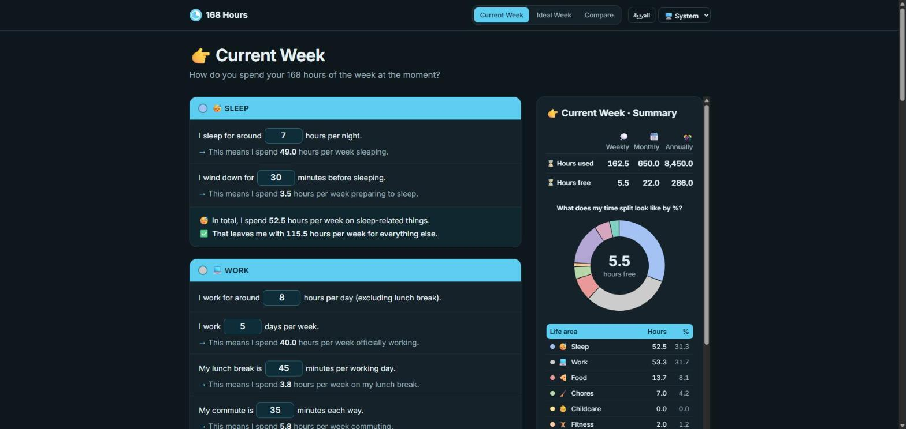

# ⏳ 168 Hours

**A free, open-source weekly time calculator.** Every week has 168 hours. Answer a few
fill-in-the-sentence questions about sleep, work, food and the rest of your life, and see
where your time goes and how much free time is really left. Then plan your ideal week and
compare the two.

Inspired by Laura Vanderkam's book
[_168 Hours: You Have More Time Than You Think_](https://lauravanderkam.com/books/168-hours/)
and by [Ali Abdaal](https://aliabdaal.com/), whose colourful site inspired the design, and built to mirror a "⏳ 168 Hours" Google Sheets template, so the numbers match the sheet
exactly.



**Live demo:** _coming soon_ <!-- Add the deployed URL here. -->

## Features

- **Sentence-style form**, worded like the spreadsheet: "I sleep for around [ 7 ] hours per
  night. → This means I spend 49.0 hours per week sleeping." Results, section totals and a
  running "✅ That leaves me with… " line update as you type.
- **Eight life areas:** 😴 Sleep, 💻 Work, 🍕 Food, 🧹 Chores, 👶 Childcare (can be marked
  "not applicable"), 🏋️ Fitness, 📺 Entertainment and 🥰 Relationships.
- **Live summary:** hours used and free, weekly / monthly / annually, a table with each area's
  hours and % of the week, a donut chart and an hours bar chart.
- **Current and Ideal weeks**, each with its own answers, plus "Copy from Current Week".
- **Compare view:** ideal minus current for every area, a diverging bar chart and a
  plain-language insight ("In your ideal week you'd gain 3.0 hours of fitness and lose 4.0
  hours of entertainment.").
- **Friendly validation:** accepts `7.5`, `7,5`, Arabic-Indic digits and empty boxes (0); caps
  impossible values (e.g. 8 work days) with a note; warns clearly when the week goes past
  168 hours instead of showing negative free time.
- **Save and share:** saved automatically in your browser, export / import JSON backups,
  download the summary as a PNG, reset everything.
- **English and Arabic** (full right-to-left layout), **light and dark mode** (follows your
  system, or choose), mobile-first and keyboard accessible.

## Privacy

There is no backend, no account, no analytics and no cookies. Your answers are stored only in
your browser's `localStorage` and never leave your device. Exported files are created
locally.

## Getting started

Requires Node.js 20.19 or newer.

```bash
npm install
npm run dev        # http://localhost:5173
```

### Scripts

| Script                 | What it does                                          |
| ---------------------- | ----------------------------------------------------- |
| `npm run dev`          | Start the dev server with hot reload                  |
| `npm run build`        | Type-check and build the static site into `dist/`     |
| `npm run preview`      | Serve the production build locally                    |
| `npm test`             | Run all unit and component tests once (Vitest)        |
| `npm run test:watch`   | Run tests in watch mode                               |
| `npm run lint`         | ESLint (TypeScript, React hooks, accessibility rules) |
| `npm run typecheck`    | Strict TypeScript check                               |
| `npm run format`       | Format everything with Prettier                       |
| `npm run format:check` | Check formatting (used in CI)                         |

### Deploying

`npm run build` produces a fully static site in `dist/`. It uses relative asset paths and a
hash router (`#/week/current`), so it works on GitHub Pages, Netlify, Vercel or any static
host from any sub-path, with no server configuration.

## How the maths works

All formulas live in [`src/lib/calc.ts`](src/lib/calc.ts) as pure functions, with the matching
spreadsheet cell noted next to each line. Everything is in hours per week.

| Area             | Formula                                                                                                       |
| ---------------- | ------------------------------------------------------------------------------------------------------------- |
| 😴 Sleep         | hours per night × 7 + wind-down minutes × 7 ÷ 60                                                              |
| 💻 Work          | hours per day × days + (lunch minutes + commute minutes × 2 + get-ready minutes + change minutes) × days ÷ 60 |
| 🍕 Food          | (breakfast eat + prep) × 7 ÷ 60 + (lunch eat + prep) × (7 − work days) ÷ 60 + (dinner eat + prep) × 7 ÷ 60    |
| 🧹 Chores        | grocery trips × minutes + cleanings × minutes + laundry loads × minutes, all ÷ 60, + misc hours               |
| 👶 Childcare     | weekday hours × 5 + weekend-day hours × 2 + admin hours + other hours (0 when "not applicable")               |
| 🏋️ Fitness       | exercise hours + other fitness hours                                                                          |
| 📺 Entertainment | TV & movies + social media + reading + gaming + other                                                         |
| 🥰 Relationships | family/partner time + other socialising                                                                       |

Then:

- **Hours used** (❌ Total Non-Free Time) = the sum of the eight areas.
- **Free time** (✅) = 168 − hours used. If that is negative, the app shows 0 free time and a
  warning with how many hours over the week is.
- **Monthly** = weekly × 4 and **annually** = weekly × 52, like the sheet.
- **% of the week** = hours ÷ 168 × 100.
- **Compare** = ideal − current for each area. Free time is compared un-clamped (like the
  sheet's "VS CURRENT WEEK" column), so its difference is always the opposite of the
  difference in hours used.

Work-day lunches are counted under Work (as the lunch break), so Food only counts lunch on
non-work days. Example from the definition of done: sleeping 7 hours a night with 30 minutes
of wind-down is 52.5 hours, leaving 115.5.

**Spreadsheet parity.** [`scripts/generate_parity_fixture.py`](scripts/generate_parity_fixture.py)
evaluates the original `.xlsx` with real inputs and saves the results as a fixture;
[`calc.parity.test.ts`](src/lib/calc.parity.test.ts) checks `calc.ts` gives the same numbers.
One known bug in the template is _not_ copied: the Ideal column on the combined tab computes
fitness as `M67+M67` (exercise twice) instead of exercise + other; the separate Ideal tab and
this app use the intended sum.

## Project structure

```
src/
  lib/            Pure logic, no React: calc.ts (formulas), parse.ts (number input),
                  format.ts, storage.ts (save/load/sanitise), insight.ts, download.ts
  sections.config.ts   The 8 form sections as data (rows, limits, result lines)
  state/          Reducer and React context for both weeks (+ auto-save)
  hooks/          useWeekData, useLocalStorage, useTheme
  components/     form/ (Section, SentenceRow), summary/ (panel, charts, PNG), layout/
  pages/          Landing, Week (current/ideal), Compare
  i18n/           i18next setup and locales/en.json, locales/ar.json
```

The eight sections are rendered by one `Section` component from `sections.config.ts`, and
every visible string lives in the locale files. Tests check that the config, the maths and
both languages stay in sync (same keys, same placeholders).

## Contributing

Contributions are welcome. See [CONTRIBUTING.md](CONTRIBUTING.md) for the workflow, and please
open an issue first for larger changes. Adding a language means adding one JSON file in
`src/i18n/locales/`; the tests tell you if a key or placeholder is missing.

## Credits

- The idea and the 168-hour framing come from **Laura Vanderkam**'s book
  [_168 Hours_](https://lauravanderkam.com/books/168-hours/). This project is not affiliated
  with or endorsed by the author.
- The playful look (cream backgrounds, hand-drawn underlines, bright cards) is inspired by
  [Ali Abdaal](https://aliabdaal.com/)'s website. Not affiliated with or endorsed by him either.
- The form wording, formulas and area colours follow the "⏳ 168 Hours Template" spreadsheet
  this app was built from.
- Fonts: [Fraunces](https://fonts.google.com/specimen/Fraunces), [Inter](https://rsms.me/inter/) and
  [IBM Plex Sans Arabic](https://github.com/IBM/plex) (both SIL Open Font License).

## License

[MIT](LICENSE)
